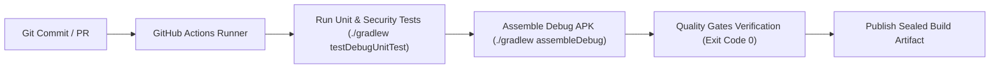

# Phase 6 — Software Supply Chain & DevSecOps Security

**Document ID**: `59-phase-6-supply-chain-devsecops`  
**Phase**: Phase 6 of 10 — Comprehensive Security Transformation  
**Program**: Relief Distribution System Modernization (`com.example.reliefdistribution`)  
**Standard**: SLSA (Supply-chain Levels for Software Artifacts) / NIST SP 800-161  

---

## 1. Executive Summary

This document establishes the software supply chain defense, dependency validation, build pipeline security, and DevSecOps quality gates enforced across the Relief Distribution System.

---

## 2. Dependency Management & Version Catalog Integrity

### 2.1 Trusted Repositories
The build configuration strictly restricts artifact resolution to verified official repositories:
- `google()`: Google Maven for AndroidX and Firebase SDKs.
- `mavenCentral()`: Sonatype Maven Central for open-source Java/Kotlin libraries.
- **Untrusted / Unencrypted HTTP Repositories**: Strictly forbidden.

### 2.2 Gradle Dependency Inventory & Scoping
- **Build System**: Gradle 8.9 (Kotlin DSL) with Android Gradle Plugin 8.7.3.
- **Core Dependencies**:
  - `androidx.appcompat:appcompat:1.7.0`
  - `com.google.android.material:material:1.12.0`
  - `com.google.firebase:firebase-database:21.0.0`
  - `com.google.firebase:firebase-auth:23.0.0`
  - `com.google.android.gms:play-services-maps:19.0.0`
  - `com.google.android.gms:play-services-location:21.3.0`
- **Dynamic Versions**: Disallowed (no `+` or open-ended wildcards in production dependencies).

---

## 3. CI/CD Pipeline & Build Security (`.github/workflows/android.yml`)

### 3.1 Pipeline Security Controls
1. **Zero Secret Leaks in Version Control**: API keys, signing keystores, and credentials are kept out of Git.
2. **Deterministic Builds**: Build steps run with fixed Gradle versions (`gradle-8.9`).
3. **Automated Security Test Suite**: Every commit executes all 103 unit and security regression tests.

---

## 4. Release Build Hardening & Obfuscation (R8)

Release binaries are compiled with Google R8 code shrinking and optimization:
- Obfuscates non-public class and method names.
- Eliminates unused classes and resources to shrink APK footprint.
- Preserves Firebase data models through explicit `-keep class com.example.reliefdistribution.data.model.**` rules.
- Strips all `android.util.Log` and `PrintStream` calls to prevent production information leakage.
