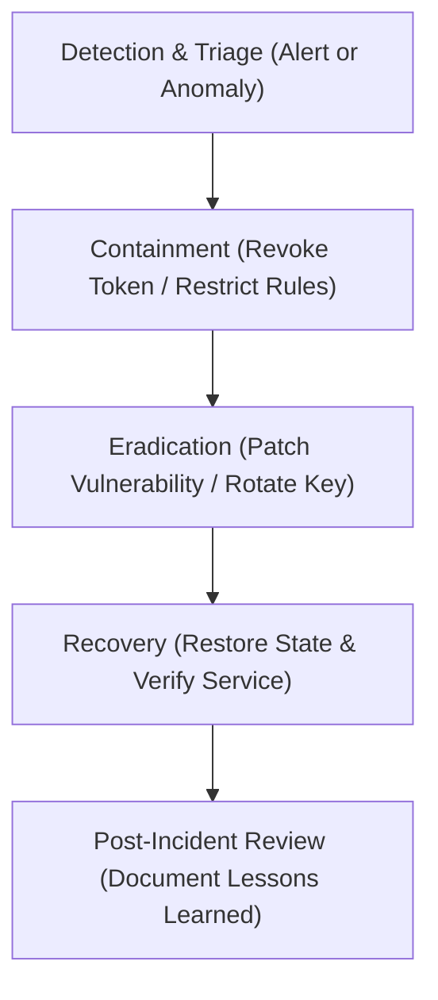

# Phase 6 — Security Operations & Incident Response Runbook

**Document ID**: `64-phase-6-security-operations`  
**Phase**: Phase 6 of 10 — Comprehensive Security Transformation  
**Program**: Relief Distribution System Modernization (`com.example.reliefdistribution`)  
**Standard**: NIST SP 800-61 Rev. 2 (Computer Security Incident Handling Guide)  

---

## 1. Executive Summary

This document establishes the security operations procedures, incident response runbooks, cryptographic key rotation workflows, and monitoring guidelines for operating the Relief Distribution System securely in production disaster environments.

---

## 2. Incident Response Runbooks

### 2.1 Runbook IR-01: Compromised Distributor Account
- **Trigger**: Unusual batch inventory deductions or reports of unauthorized dispatch assignments.
- **Immediate Containment**:
  1. Access Firebase Console -> Authentication -> Users.
  2. Locate the compromised user UID and click **Disable Account**. This immediately invalidates token refresh and denies further RTDB read/write access.
  3. Revert any tampered `/Inventory` records to physical depot counts.
- **Eradication & Recovery**:
  1. Force password reset via email.
  2. Verify identity with the distributor agency coordinator before re-enabling the account.

### 2.2 Runbook IR-02: Google Maps API Key Exposure
- **Trigger**: Unrecognized spikes in Google Cloud Platform Geocoding or Maps SDK API usage.
- **Immediate Containment**:
  1. Access Google Cloud Console -> APIs & Services -> Credentials.
  2. Generate a new API Key with strict Android application restrictions (`com.example.reliefdistribution` + SHA-1 fingerprints).
  3. Update `MAPS_API_KEY` in `local.properties` (or CI secret environment variables).
  4. Deprecate the old API key with a 24-hour grace deletion window.

### 2.3 Runbook IR-03: Realtime Database Request Flooding / Bot Spam
- **Trigger**: Sudden influx of hundreds of relief requests per minute from a single IP or user account.
- **Immediate Containment**:
  1. Inspect `/ReliefRequests` for repetitive notes or coordinate clustering.
  2. In Firebase Console -> Rules, enable emergency rate limiting or temporarily enforce `auth.token.firebase.sign_in_provider != 'anonymous'`.
  3. Enable Firebase App Check with Play Integrity enforcement to drop requests originating from non-genuine Android clients.

---

## 3. Cryptographic Key Rotation Policy

| Secret / Key Name | Storage Location | Recommended Rotation Cycle | Emergency Rotation Procedure |
| :--- | :--- | :--- | :--- |
| **Google Maps API Key** | `local.properties` / GCP Console | 180 Days | Regenerate in GCP, update CI secrets, trigger release build |
| **Android Release Keystore** | Secure Hardware Vault / HSM | 25 Years (Google Play Managed) | Request key reset via Google Play Console developer support |
| **Firebase Service Account** | CI/CD Secrets | 90 Days | Generate new private key in Firebase Console, revoke previous |

---

## 4. Security Monitoring & Telemetry Guidelines

- **Log Filtering**: Ensure operational logs are ingested into a secure SIEM without storing unmasked PII.
- **Firebase Usage Alerts**: Configure budget and quota alerts at 80% thresholds in Google Cloud Console.
- **Crash Reporting**: Ensure crash traces exclude user-supplied notes and PII by reviewing breadcrumb hooks.
