# Phase 7 — Performance Inventory & Critical Workload Modeling

**Document ID**: `67-phase-7-performance-inventory`  
**Phase**: Phase 7 of 10 — Performance, Scalability & Reliability Engineering  
**Program**: Relief Distribution System Modernization (`com.example.reliefdistribution`)  

---

## 1. Executive Summary

This document establishes the end-to-end performance inventory, workload characteristics, critical user journeys, and dependency maps for the Relief Distribution System following the security transformation in Phase 6.

Humanitarian disaster operations present unique performance challenges: cellular networks suffer intermittent blackouts and bandwidth throttling, mobile devices operate on depleted battery banks, and relief coordinators handle bursts of urgent aid requests and real-time fleet breadcrumbs simultaneously.

---

## 2. Critical User Journey Mapping

```mermaid
flowchart TD
    subgraph J1["Journey 1: Survivor Emergency Aid Request"]
        S1["User Submits Form"] --> S2["SecuritySanitizer (Strip Tags & Bounds)"]
        S2 --> S3["AI Triage Advisor (Memoized Scoring)"]
        S3 --> S4["Firebase RTDB Commit (/ReliefRequests)"]
        S4 --> S5["Distributor Notification Dispatch"]
    end

    subgraph J2["Journey 2: Edge Fleet Telemetry & GPS Tracking"]
        G1["FusedLocationProvider GPS Fix"] --> G2["Velocity & Battery Adaptive Sampling"]
        G2 --> G3["Stationary Compaction (<5m deduplication)"]
        G3 --> G4["OfflineTelemetryBuffer (Max 100 FIFO)"]
        G4 --> G5["Atomic Batch Cloud Sync on Reconnect"]
    end

    subgraph J3["Journey 3: Distributor Aid Triage & Stock Reservation"]
        D1["ManageRequests Screen Render"] --> D2["Cached In-Memory Dataset"]
        D2 --> D3["Filter by Status / Priority Tier"]
        D3 --> D4["Claim Aid Request (Atomic Transaction)"]
        D4 --> D5["Stock Reservation & Notification"]
    end
```

---

## 3. Performance-Sensitive Subsystem Inventory

| Subsystem | Primary Operation | Critical Path Latency Target | Resource Constraints |
| :--- | :--- | :---: | :--- |
| **Android UI & Rendering** | Screen transition & list scrolling | < 16.6ms (60 FPS) / < 8.3ms (120 FPS) | Heap memory < 64MB; zero main-thread stalls |
| **AI Triage Advisor** | Keyword parsing & risk heuristic | < 1.0ms (cold), < 0.05ms (cached) | Pure offline CPU; zero network dependencies |
| **In-Memory Caching** | Profile, alert & inventory reads | < 0.1ms | Max capacity caps; bounded memory (< 5MB) |
| **IoT Telemetry Buffer** | GPS enqueue & stationary compaction | < 0.2ms | Max 100 items; zero unbounded allocations |
| **Resilience & Breaker** | Circuit state evaluation & backoff | < 0.01ms | Atomic counters; fail-fast cool-downs |
| **Firebase Cloud RTDB** | WebSocket writes & queries | p50 < 300ms, p95 < 1200ms | 3G / 2G degraded disaster cellular |

---

## 4. Workload Assumptions

- **Survivor Population**: Up to 5,000 active concurrent survivor instances during regional flood or cyclone crisis.
- **Distributor Fleet**: 50 to 200 field delivery vehicles streaming location breadcrumbs.
- **Peak Telemetry Ingestion**: 100 to 250 telemetry updates per second across the relief theater.
- **Relief Requests**: 50 to 100 new requests per minute during initial crisis phase, stabilizing to 10-20 requests/min during steady-state relief distribution.
