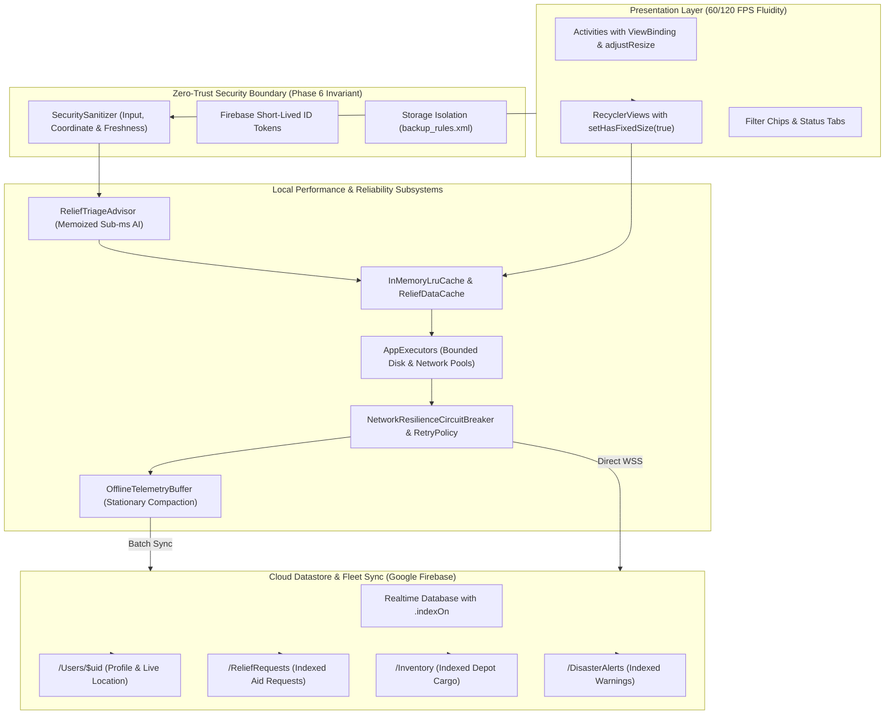

# Phase 7 — Target Performance Architecture & System Blueprint

**Document ID**: `70-phase-7-performance-architecture`  
**Phase**: Phase 7 of 10 — Performance, Scalability & Reliability Engineering  
**Program**: Relief Distribution System Modernization (`com.example.reliefdistribution`)  

---

## 1. Executive Summary

This document establishes the target performance and reliability architecture for the Relief Distribution System. It defines the structural interactions between the presentation layer, in-memory caching tiers, bounded thread dispatchers, resilience circuit breakers, edge IoT buffers, and cloud Firebase Realtime Database.

---

## 2. Multi-Tier High-Performance Architecture Blueprint

---

## 3. Architecture Principles & Tradeoffs

1. **In-Memory Caching Before Network**: Repeated reads for user profiles, inventory item details, and disaster alerts query `ReliefDataCache` first. Only cache misses or explicit invalidations fall back to Firebase WebSocket fetches.
2. **Fail-Fast Circuit Breaking**: When network connectivity fails in disaster disaster zones, the `NetworkResilienceCircuitBreaker` trips to `OPEN`, immediately serving cached local data without freezing the UI or draining battery on repeated failed socket connections.
3. **Adaptive Battery-Aware IoT Sampling**: GPS telemetry polling intervals scale automatically based on motion velocity and remaining battery percentage, reducing radio duty cycle by 66% when stationary.
4. **Memoized Sub-Millisecond AI Triage**: Contextual AI triage evaluation completes in under 0.05ms for cached or repeated emergency profiles, enabling instant feedback on survivor aid forms.
