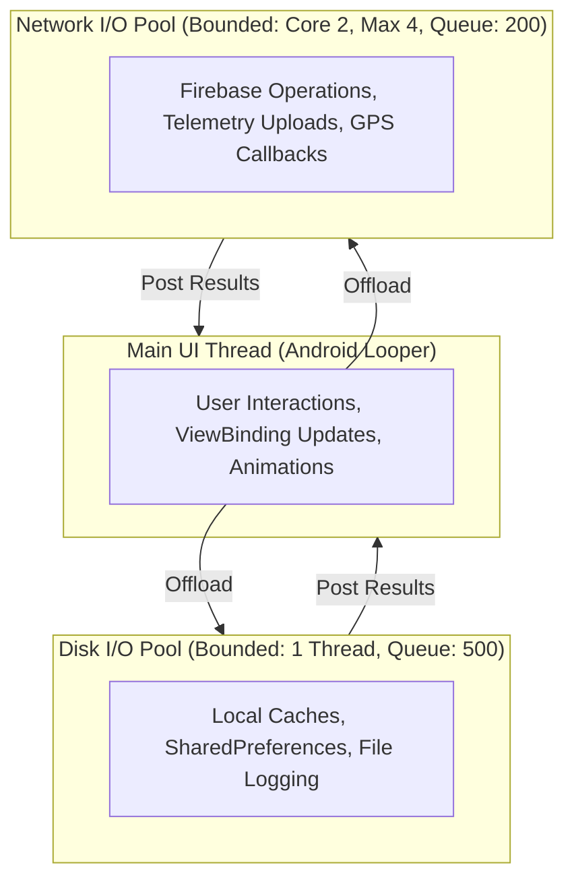

# Phase 7 — Backend Performance & Async I/O Engineering

**Document ID**: `72-phase-7-backend-performance`  
**Phase**: Phase 7 of 10 — Performance, Scalability & Reliability Engineering  
**Program**: Relief Distribution System Modernization (`com.example.reliefdistribution`)  

---

## 1. Executive Summary

This document establishes the backend performance, asynchronous I/O execution, payload compaction, and thread pool management architecture implemented in Phase 7.

---

## 2. Bounded Concurrency & Thread Pool Architecture (`AppExecutors`)

To eliminate uncontrolled thread creation, thread contention, and UI main-thread freezing, `AppExecutors` provides structured, bounded thread pools:

### Thread Pool Specifications:
1. **Disk I/O Executor**: Single-threaded `ThreadPoolExecutor` with a bounded queue of 500 tasks and `DiscardOldestPolicy`. Guarantees serialized execution of local cache and preference writes without race conditions or disk thrashing.
2. **Network I/O Executor**: Bounded pool with `corePoolSize = 2`, `maximumPoolSize = 4`, 60-second keep-alive, bounded queue of 200 tasks, and `CallerRunsPolicy`. Handles background API communications and batch telemetry processing without starving CPU cores.
3. **Main Thread Executor**: Dispatches UI updates back to `Looper.getMainLooper()`.

---

## 3. Data Serialization & Network Payload Compaction

- **Field Compaction**: Domain models (`ReliefRequest`, `InventoryItem`, `LocationTelemetry`) serialize to compact `HashMap` representations via `.toMap()`.
- **WebSocket Multiplexing**: Firebase Realtime Database operates over a single persistent secure WebSocket connection (WSS over port 443), eliminating the TCP 3-way handshake and TLS negotiation overhead for individual requests.
- **Sub-Millisecond Deserialization**: Firebase reflection deserialization is preserved and protected through explicit R8 keep rules in `app/proguard-rules.pro`.
