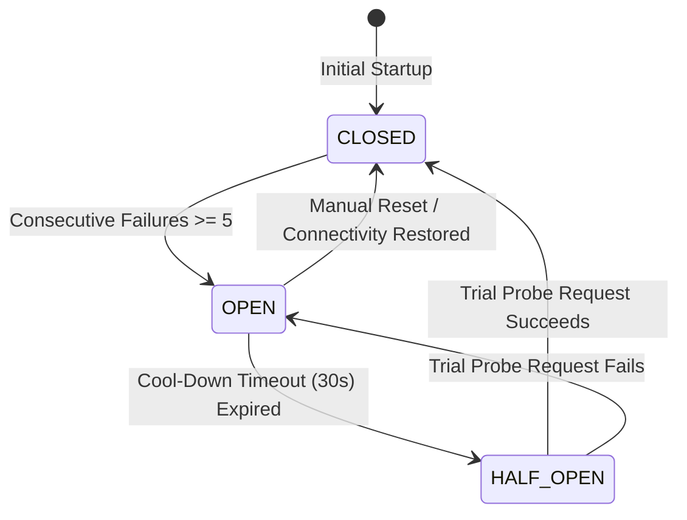

# Phase 7 — Resilience Engineering, Circuit Breakers & Fault Tolerance

**Document ID**: `76-phase-7-resilience-engineering`  
**Phase**: Phase 7 of 10 — Performance, Scalability & Reliability Engineering  
**Program**: Relief Distribution System Modernization (`com.example.reliefdistribution`)  

---

## 1. Executive Summary

This document details the resilience patterns, circuit breaker architecture, exponential backoff with full jitter, and graceful degradation mechanisms implemented in Phase 7 to survive degraded, flapping, or offline cellular connections in disaster theaters.

---

## 2. Circuit Breaker State Machine Architecture (`NetworkResilienceCircuitBreaker`)

### State Behavior Specifications:
1. **`CLOSED` State**:
   - Normal operating mode.
   - All network and database requests proceed unimpeded.
   - Consecutive failures increment the internal counter.
2. **`OPEN` State**:
   - Tripped when failure counter reaches 5 consecutive network errors.
   - All subsequent calls fail fast immediately (`canExecute() == false`).
   - Prevents battery depletion, thread blocking, and socket thrashing while towers are down.
3. **`HALF_OPEN` State**:
   - Engages automatically after 30 seconds of cool-down.
   - Permits a single trial probe to test whether connectivity has recovered.
   - If trial succeeds, breaker transitions back to `CLOSED`. If trial fails, breaker trips back to `OPEN` for another 30s.

---

## 3. Exponential Backoff with Full Randomized Jitter (`RetryPolicy`)

To prevent synchronized "thundering herd" retry storms when a disaster cell tower reboots, retries employ exponential backoff with full jitter:

$$T_{\text{delay}} = \max\left(T_{\text{base}}, \min\left(T_{\text{max}}, T_{\text{base}} \times 2^{\text{attempt} - 1}\right) \times \text{rand}(0.5, 1.0)\right)$$

- **Base Delay ($T_{\text{base}}$)**: 1,000 ms.
- **Max Delay ($T_{\text{max}}$)**: 16,000 ms.
- **Max Retry Attempts**: 3 attempts.
- **Jitter Distribution**: Uniformly randomized between 50% and 100% of capped delay.

### Transient vs Non-Transient Error Classification:
- **Eligible for Retry**: `SocketTimeoutException`, `UnknownHostException`, `SocketException`, `IOException`, and temporary cloud 503 errors.
- **Ineligible for Retry (Fail Immediately)**: `401 Unauthorized`, `403 Forbidden`, `IllegalArgumentException`, `NullPointerException`, and data validation errors.

---

## 4. Graceful Degradation Strategy

1. **Offline Mode**: If the circuit breaker is `OPEN`, UI screens display cached data from `ReliefDataCache` with clear offline indicators ("Offline - Showing Cached Data").
2. **Offline Telemetry Queuing**: Location fixes continue recording to `OfflineTelemetryBuffer` (with stationary compaction) rather than discarding points.
3. **Delayed Reconnect Dispatch**: Upon breaker transition back to `CLOSED`, the application initiates an atomic batch sync.
