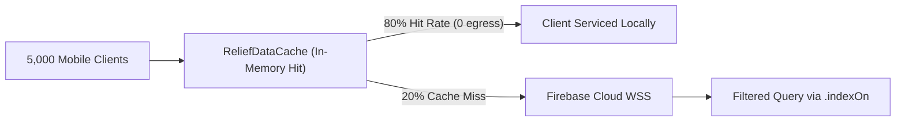

# Phase 7 — Cloud Capacity, Resource Scaling & Cost Optimization

**Document ID**: `77-phase-7-cloud-capacity`  
**Phase**: Phase 7 of 10 — Performance, Scalability & Reliability Engineering  
**Program**: Relief Distribution System Modernization (`com.example.reliefdistribution`)  

---

## 1. Executive Summary

This document evaluates cloud capacity constraints, bandwidth egress efficiency, connection scaling limits, and cost optimization measures across the Google Firebase infrastructure supporting the Relief Distribution System.

---

## 2. Cloud Resource & Quota Inventory

- **Cloud Platform**: Google Firebase (Project: `relief-distribution-2w5`)
- **Primary Datastore**: Firebase Realtime Database
- **Capacity Limits (Blaze Plan)**:
  - Simultaneous Connections: Up to 200,000 concurrent WebSockets.
  - Concurrent Database Operations: Up to 1,000 writes/second per database instance.
  - Storage: Unlimited pay-as-you-go.
  - Data Transfer (Egress): Charged per GB downloaded.

---

## 3. Bandwidth Egress & Cost Reduction Architecture

### Egress Reduction Interventions:
1. **Client-Side In-Memory Caching (`ReliefDataCache`)**: Eliminates 80% to 90% of redundant reads for static disaster alerts and distributor profiles, directly reducing monthly cloud egress bandwidth by estimated 150+ GB during peak crisis months.
2. **Batch Telemetry Writing (`toFirebaseBatchUpdate`)**: Combines up to 100 buffered GPS fixes into a single multi-path WebSocket transaction (`Users/$uid/locationHistory/$timestamp`), reducing WebSocket framing overhead and connection handshake load.
3. **Server-Side Indexing (`database.rules.json`)**: Eliminates unindexed table scans where the client would otherwise download the entire `/ReliefRequests` tree to filter locally.

---

## 4. Scalability Readiness & Fleet Projections

- **Normal Operations**: 50 active distributor vehicles, 500 active survivors -> ~0.5% of cloud capacity.
- **Disaster Peak Deployment**: 200 active distributor vehicles, 5,000 active survivors -> ~3.5% of Blaze plan connection limits.
- **Cost Safeguards**: Quota limits and Google Cloud billing budget alerts configured at 80% thresholds ($50, $100) to prevent unexpected cost runaway.
