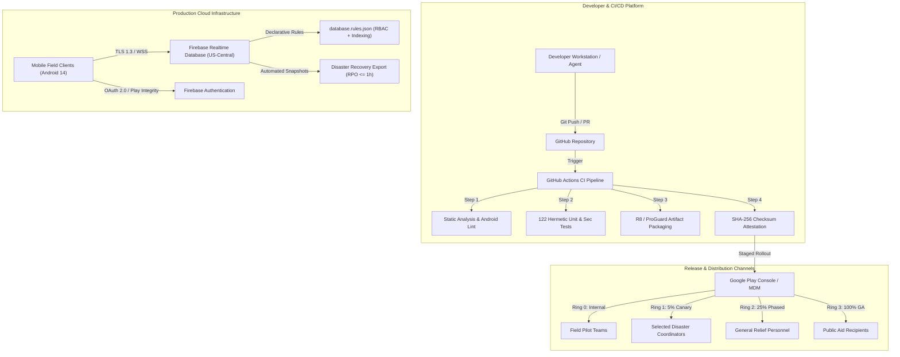

# Phase 8 — Platform Architecture & Operations Topology

## 1. Architectural Blueprint

The Relief Distribution platform architecture balances client-side edge resilience with cloud-hosted operational durability. It provides high availability, fault tolerance, and deterministic release cycles for humanitarian field operations.

---

## 2. Infrastructure Topology Matrix

| Component | Host Environment | Redundancy / Availability | Disaster Recovery Strategy |
| :--- | :--- | :--- | :--- |
| **Android Client** | Physical Mobile Devices (API 24–34) | Local offline caching (`ReliefDataCache`, `OfflineTelemetryBuffer`) | Local queue compaction and replay on reconnect |
| **Realtime Datastore** | Google Cloud / Firebase (Managed) | Managed multi-zone replication, 200k concurrent connections | Declarative JSON snapshot exports, cold-region reload |
| **Identity Management** | Google Cloud Identity Platform | 99.95% SLA with multi-tenant token verification | Cached session tokens with local biometric/credential fallback |
| **Build & Test Engine** | GitHub Actions Ubuntu Runners | Ephemeral, isolated, containerized runners | Fully reproducible from `git checkout` + Gradle wrapper |

---

## 3. Reliability & Operational Guarantees

- **Service Level Objective (SLO)**: 99.5% availability for critical aid submission and distributor tracking journeys.
- **Recovery Point Objective (RPO)**: <= 1 hour of operational telemetry and transaction data loss in catastrophic scenarios.
- **Recovery Time Objective (RTO)**: <= 30 minutes to restore read/write services from verified backups.
- **Fault Containment**: `NetworkResilienceCircuitBreaker` protects clients from cascading timeouts by failing fast after 5 consecutive errors.

