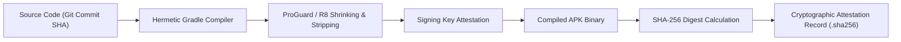

# Phase 8 — Build Artifact Security & Cryptographic Provenance

## 1. Threat Model for Mobile Build Artifacts

Humanitarian relief operations require unassailable binary integrity. Compromised or tampered client binaries could enable malicious adversaries to spoof distributor locations, steal relief aid, or inject unauthorized emergency alerts.

---

## 2. Hardening Invariants & Controls

1. **R8 / ProGuard Obfuscation & Log Stripping**:
   - `proguard-rules.pro` strips all calls to `android.util.Log` (`v`, `d`, `i`, `w`) and `System.out.println` from production builds to eliminate information leakage.
   - Preserves model schemas (`com.example.reliefdistribution.data.model.**`) for Firebase reflection deserialization.
2. **Deterministic Cryptographic Attestation**:
   - For every compiled APK, a cryptographic SHA-256 digest is generated via `sha256sum` or `[System.Security.Cryptography.SHA256]` and archived alongside the binary.
   - Clients and MDM administrators verify the SHA-256 digest prior to deploying APK updates in disaster zones.
3. **Reproducible Compilation**:
   - Compiler compatibility fixed to Java 11 bytecode via `compileOptions` in `app/build.gradle.kts`.
   - Manifest placeholders inject the Google Maps API key strictly from local configuration or environment variables, preventing secret embedding in repository code.

