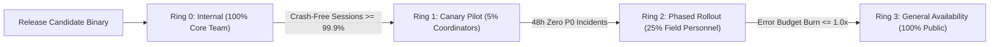

# Phase 8 — Progressive Delivery, Staged Rollouts & Release Engineering

## 1. Release Track Architecture

To eliminate release-induced outages during active disaster coordination, deployments follow a progressive ring topology with automated health verification at every tier:

---

## 2. Release Rollback Protocol & Automated Halt Gates

1. **Crash Threshold Halt Gate**: If crash-free sessions drop below **99.5%** during any staged rollout phase, Google Play distribution is automatically halted via API or manual trigger.
2. **Error Budget Depletion Halt Gate**: If the 1-hour error budget burn rate exceeds **14.4x** (indicating 2% of monthly budget consumed in 1 hour), the rollout is immediately suspended.
3. **Database Schema Backward Compatibility**: All cloud database migrations must follow the Expand/Contract (Parallel Run) pattern. New app releases must gracefully parse existing nodes, and older client versions must safely ignore newly added fields.
4. **Binary Rollback Strategy**: When an active binary rollback is required, an expedited hotfix build incrementing `versionCode` and reverting problematic logic is promoted directly to Ring 0 and Ring 1 within a 2-hour SLA.

