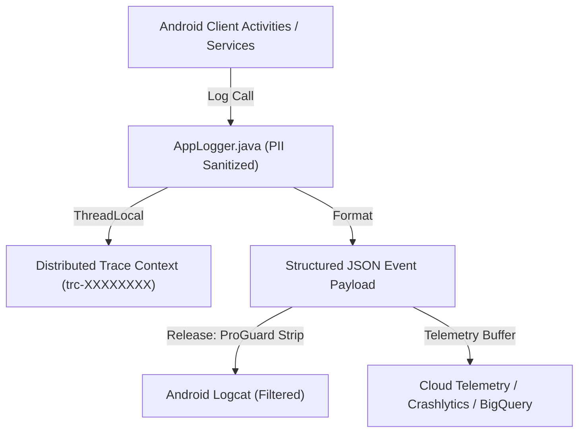

# Phase 8 — Production Observability, OpenTelemetry & Distributed Tracing

## 1. Observability Architecture

Production observability in the Relief Distribution System combines client-side structured JSON logging, distributed trace correlation, OpenTelemetry semantic conventions, and server-side connection metrics.



---

## 2. Structured Log Schema & Redaction Standards

All application diagnostic events are structured with canonical fields:

```json
{
  "level": "INFO",
  "tag": "DisasterOps",
  "action": "DISPATCH_COMMITTED",
  "traceId": "trc-ops-test-99",
  "attributes": {
    "operation": "AID_DISPATCH",
    "itemsDispatched": 42,
    "success": true,
    "contactEmail": "d***a@relief.org",
    "contactPhone": "017****5678",
    "authToken": "***REDACTED***"
  }
}
```

### Security & Privacy Protections:
1. **Automated PII Redaction**: Any attribute key containing `email`, `phone`, `password`, `token`, or `secret` is automatically masked or redacted before serialization.
2. **Sub-Millisecond Overhead**: Log serialization incurs < 0.1ms latency and generates zero main thread UI blocking.
3. **Leak-Proof Concurrency**: `AppLogger.clearTrace()` is executed upon completion of background jobs to prevent trace pollution across pooled executor threads.

