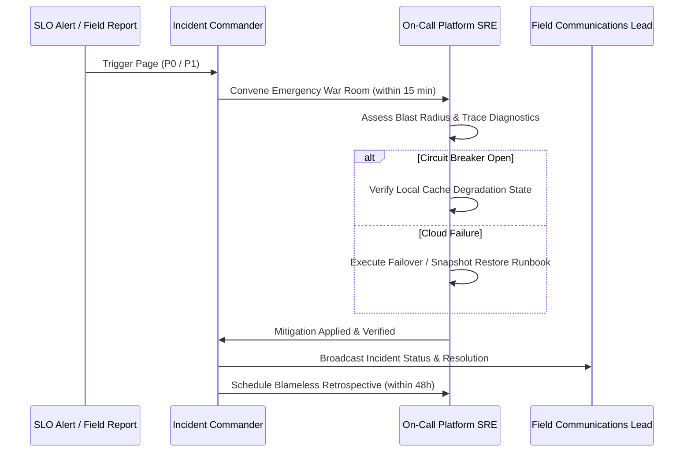

# Phase 8 — Incident Response Protocols & Severity Triage Matrix

## 1. Incident Classification Framework

When an operational disruption occurs in the field, response teams categorize the event according to this standard severity taxonomy:

| Severity Level | Definition | Response SLA | Escalation Target |
| :--- | :--- | :--- | :--- |
| **P0 — Critical Emergency** | Complete database outage, login breakdown, or aid submission failure affecting >5% of disaster survivors | **<= 15 minutes** | Primary Platform On-Call + Lead Architect + Relief Incident Commander |
| **P1 — Major Incident** | AI triage offline, distributor telemetry delay > 60s, or partial regional network partition | **<= 1 hour** | Secondary On-Call + SRE Lead |
| **P2 — Moderate Disruption** | Non-critical UI rendering defect, slow search queries, or delay in non-urgent notification push | **<= 4 hours** | Development Lead |
| **P3 — Minor Glitch** | Cosmetic text truncation or minor non-blocking UI styling inconsistency | **<= 24 hours** | Next sprint backlog triage |

---

## 2. Standard Incident Response Workflow

---

## 3. Post-Incident Review & Blameless Retrospectives

Within 48 hours of resolving any P0 or P1 incident:
1. Conduct a blameless retrospective analyzing timeline, contributing factors, detection gaps, and system resilience.
2. Publish an Incident Postmortem document detailing:
   - Root cause analysis (5 Whys methodology).
   - Recovery Time (MTTR) and detection duration (MTTD).
   - Preventative engineering tasks added directly to the backlog.

