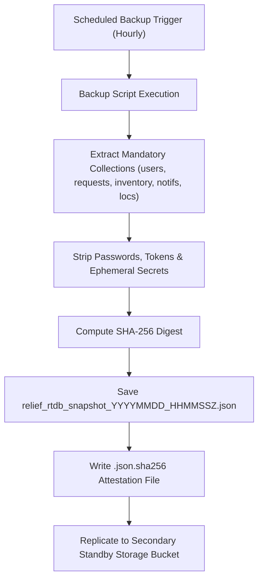

# Phase 8 — Disaster Recovery & Backup Engineering

## 1. Objectives & Metrics

Disaster Recovery (DR) protocols ensure operational continuity and data preservation for life-saving aid coordination even under severe infrastructure destruction or cloud regional failure.

- **Recovery Point Objective (RPO)**: <= 1 hour (maximum permissible loss of active operational records).
- **Recovery Time Objective (RTO)**: <= 30 minutes (time required to restore functional read/write services from a snapshot).

---

## 2. Automated Snapshot Architecture

Snapshot generation is automated via declarative tools:
- `scripts/Backup-FirebaseRtdb.ps1`: Native PowerShell export utility for Windows environments.
- `scripts/backup_firebase_rtdb.py`: Python CLI export utility for Linux CI/CD runners.

---

## 3. Restoration & Verification Drills

1. **Automated Schema Verification**: Every export script performs an immediate read-back test verifying JSON syntax, required metadata keys (`snapshot_id`, `schema_version`, `checksum_sha256`), and mandatory collections.
2. **Monthly Recovery Drills**: Recovery drills restore the latest snapshot to an isolated staging instance (`relief-distribution-staging`) to confirm relational integrity, foreign key references, and role assignments.
3. **Immutability (WORM)**: Backup buckets are configured with Object Lock and 90-day retention policies, preventing accidental deletion or ransomware alteration.

