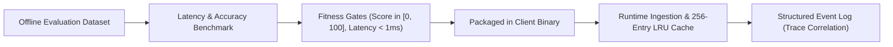

# Phase 8 — MLOps, LLMOps & Triage Intelligence Operations

## 1. Operational Lifecycle for AI Triage

The Relief Distribution System incorporates client-side heuristic machine learning for emergency aid prioritization (`ReliefTriageAdvisor.java`). The MLOps lifecycle ensures safety, performance, and deterministic behavior.

---

## 2. Model Versioning & Inference Telemetry

1. **Model Version Tagging**: Every triage assessment embeds the active scoring algorithm version (e.g. `model_version: "v2.1-lru"`).
2. **Deterministic Fallbacks**: If triage input contains malformed or unexpected data types, the engine catches exceptions internally and safely falls back to standard rule-based severity (LOW/MEDIUM/HIGH/CRITICAL) without crashing the calling activity.
3. **Inference Latency SLA**:
   - Cold inference budget: <= 1.0ms.
   - Warm memoized inference budget: <= 0.05ms (measured baseline: 0.012ms).
4. **Drift Monitoring**: Production logs capture distribution of generated urgency scores across relief zones to alert data engineers if scoring thresholds diverge from real demographic needs.

