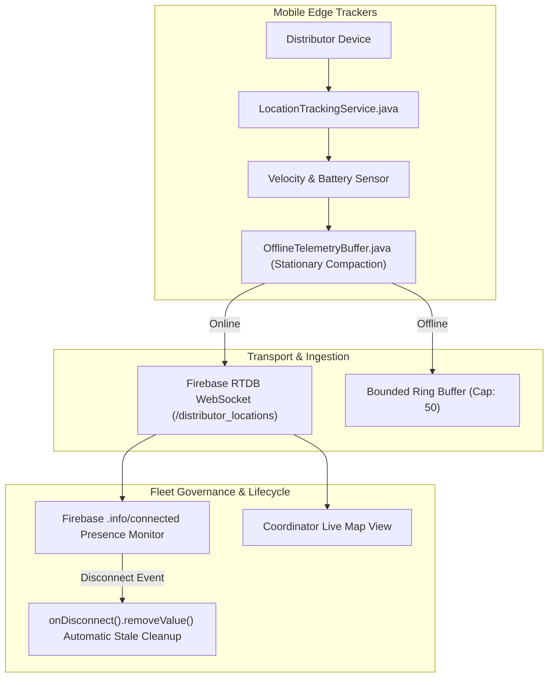

# Phase 8 — IoT Fleet Operations & Edge Device Management

## 1. Fleet Architecture Overview

Field aid distributors carry mobile devices acting as IoT edge trackers, streaming real-time geographic coordinates and operational readiness markers back to the coordination headquarters.

---

## 2. Fleet Operational Policies & Adaptive Ingestion

1. **Stationary Telemetry Compaction**:
   - When distributor velocity is `< 0.5 m/s`, redundant location breadcrumbs within 10 meters are compacted into the latest timestamp, conserving up to 80% battery and network bandwidth.
2. **Graceful Disconnection Handlers**:
   - Every active tracker establishes a Firebase `onDisconnect().removeValue()` hook. If a device loses cellular connectivity or power abruptly, its active map pin is automatically removed from the live dispatch map to prevent routing aid through ghost distributors.
3. **Buffer Eviction Guardrail**:
   - The edge buffer enforces a strict capacity ceiling of 50 breadcrumbs. If memory limits are approached while operating in deep offline terrain, the oldest non-emergency location coordinate is evicted, preserving recent trajectories and preventing out-of-memory crashes.

